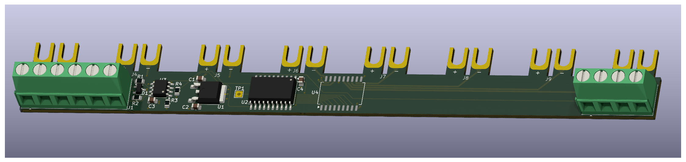

# TinyModbus
This is a simple little ATTINY program intended to act as a MODBUS device, processing inputs for up to 8 relays.

The PCB design is in the `pcb` folder.  It is set up to allow 8 [PTF08A](https://www.aliexpress.com/w/wholesale-PTF08A.html?spm=a2g0o.home.search.0) housings with [Omron LY2](https://www.omron.com.au/products/family/949/lineup.html) relays side by side.  The PCB automatically slots beneath the housings.



Originally, the thought was that there could be a single MODBUS controller and LDO, and child devices could simply be daisy chained from the right hand connector to allow for more bits.  This works, but its probably neater just to use multiple MODBUS transcievers, even thought this does make the BOM cost of the devices a bit more.  The pass through may be disabled in a later version of this software. 

This device should use a tiny amount of power.  It will spend most of its time in Standby mode, using less than 1uA of power.

## Device addressing
Talk to the device using Modbus RTU, 9600 Baud N81 parity.

Each device can have its own Modbus Device Address programmed using byte 0 of the USERROW EEPROM value.  Whatever is written will have 2 added to it.  This means that the default value of 0xFF will translate to 1.  If you write 0 then it will have a deviceId of 2, and so on and so forth.

See the `configure` makefile target for an exmaple of how to program it

```sh
pymcuprog -t uart -u ${PORT} -d ${DEVICE} -m user_row write -l 0x01
```

### Supported Modbus Commands
1. 0x01 - *Get Coils* - Read in the current value of coils.  This only works on the first 8 coils, as we can't read in the values from child devices
1. 0x05 - *Set Single Coil* - Changes the value of a single coil.  If you pass in an address higher than 8, it will pass on the request to child devices with 8 taken off the address.  Effectively, it can act as an 8 bit shift register, running on the Modbus protocol. 
1. 0x0F - *Set Multiple Coils* - Sets multiple coils at once.  As above, this will pass any coil addressed higher than 8 to a child device.

The device can be daisy chained to provide a larger virtual device.


## Building
This thing just needs a version of avr-gcc with support for my CPU (attiny806) and pymcuprog.  I installed pymcuprog using pip.  I tried using the version of avr-gcc that comes from homebrew (for macs) but it didn't have the CPU support built in.  So instead, the makefile has a command `download_gcc` that will download the version used by Arduino, and host it locally.

```sh
make download_gcc
# This will both build and flash the device
make
```

Programming is done via UPDI using the test point on the board.  Use a [Serial adapter board](https://github.com/SpenceKonde/AVR-Guidance/blob/master/UPDI/jtag2updi.md) and a standard FTDI<->USB thingy.