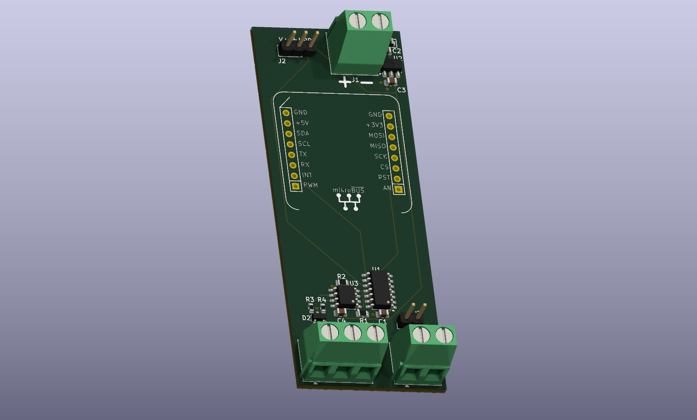

# TinyModbus DALI Gateway

An ATtiny1604-based Modbus RTU to DALI gateway. It acts as a Modbus slave device and puts DALI frames on the wire on behalf of a master.

> ## The gateway is a stateless pipe
>
> **It caches nothing about the bus.** No arc levels, no status, no presence or
> dirty bitmaps, no group masks, no commissioning state, no scan cursors. The
> master submits opaque commands over a single function code; the gateway
> executes them in accept order and hands each result back exactly once, holding
> it until the master acks it. That is the whole contract.
>
> This is deliberate — "no cache of a cache": **the ballasts are the
> authority, the controller holds the one and only cache, the gateway holds
> none.** The consequences are worth stating plainly —
>
> - **A gateway reboot is consequence-free.** There is no state to lose, so the
>   class of bug where a rebooted gateway served zeroed registers and poisoned
>   the master's cache is structurally impossible, not merely mitigated.
> - **Board replacement loses nothing.** Swap the hardware, and the controller
>   re-establishes everything by querying the ballasts.
> - **Anything reading gateway state returns ILLEGAL DATA
>   ADDRESS** — see the register map below. A client still reading those
>   addresses is a version mismatch and should fail loudly rather than receive
>   plausible zeros.
>
> The one feature that may ever grow back gateway-side is an unsolicited-frame
> event ring for DALI-2 input devices, which needs the gateway to notice frames
> the master did not ask for.

The PCB design is in the `pcb` folder. It is set up to hold an RS-485 transceiver and the DALI bus driver circuitry on a compact board.



---

## DALI Protocol

### Overview

DALI (Digital Addressable Lighting Interface) is a two-wire serial lighting control protocol standardised as IEC 62386. It allows individual control of up to 64 ballasts/drivers on a single bus, with support for groups, scenes, and bidirectional communication (status queries).

### Physical Layer

DALI runs over a simple two-wire bus. Key characteristics:

| Parameter | Value |
|-----------|-------|
| Nominal bus voltage | 16 V DC |
| Operating range | 9.5 – 22.5 V |
| Max bus current | 250 mA |
| Max cable distance | 300 m |
| Max cable voltage drop | 2 V |
| Topology | Free-form (star, daisy-chain, mixed) — ring not allowed |
| Polarity | Insensitive (either wire can be "+" or "−") |

The bus is powered by a dedicated DALI power supply. Bus-powered devices (sensors, push-button interfaces) draw power directly from it.

Signal levels:
- Logic **1** (idle/high): 16 V ± 6.5 V
- Logic **0** (active/low): 0 V ± 4.5 V

### Manchester (Biphase) Encoding

DALI uses **Manchester encoding** (also called biphase encoding) at **1200 bps**.

Each bit period is 833 µs. The bit is split into two equal half-periods of **416.67 µs** each (called Te in the standard):

```
Logic 1:  LOW  for first half-bit, HIGH for second half-bit
          ___
     ___|   |

Logic 0:  HIGH for first half-bit, LOW for second half-bit
      ___
     |   |___
```

Manchester encoding guarantees a transition in the middle of every bit, which provides self-clocking and ensures the bus never stays continuously high or low for longer than one half-bit period. This also means the DALI power supply is delivering current for at least half the time during any transmission.

### Frame Format

**Forward frame** (controller → ballast): 1 start bit + 8 address bits + 8 data bits + 2 stop bits = **19 bits**, transmitted MSB first. Total duration ≈ 15.8 ms.

```
 S  A7 A6 A5 A4 A3 A2 A1 A0  D7 D6 D5 D4 D3 D2 D1 D0  P P
 |←─── address byte ────────→|←─── data byte ─────────→|
```

S = start bit (logic 1), P = stop bits (logic 1, return bus to idle)

**Backward frame** (ballast → controller): 1 start bit + 8 data bits + 1 stop bit = **10 bits**. Duration ≈ 9.95 ms. The ballast must respond within 7–22 Te (≈ 2.9 – 9.2 ms) after the forward frame ends.

### Address Byte Structure

```
 A7  A6  A5  A4  A3  A2  A1  A0
  |   |   |   |   |   |   |   |
  |   └───┴───┴───┴───┴───┘   └── Command type: 0=DAPC, 1=Command
  └─────────────────────────────── Address type: 0=Short, 1=Group/Broadcast
```

| A7 | A6–A1 | A0 | Meaning |
|----|-------|----|---------|
| 0  | addr (0–63) | 0 | Direct Arc Power Control (DAPC) to short address |
| 0  | addr (0–63) | 1 | Command to short address |
| 1  | group (0–15) | 0 | DAPC to group |
| 1  | group (0–15) | 1 | Command to group |
| 1  | 111111 | 0/1 | Broadcast (A0=0 → DAPC, A0=1 → command) |

A queued command carries the address byte verbatim, so short addresses, groups, broadcast and the special commands are all reachable through the queue — the gateway does not interpret any of them.

### Command Types

**Direct Arc Power Control (DAPC)** — sets light output immediately:
- Data byte: 0 = off, 1–254 = proportional level (logarithmic), 255 = no change

**Standard commands** (address byte LSB = 1) — the data byte selects the command:

| Command | Data byte | Description |
|---------|-----------|-------------|
| Off | 0x00 | Turn off (no fade) |
| Up | 0x01 | Fade up by one step at the configured fade rate |
| Down | 0x02 | Fade down by one step at the configured fade rate |
| Step Up | 0x03 | Step up one level (no fade) |
| Step Down | 0x04 | Step down one level (no fade) |
| Recall Max | 0x05 | Go to maximum level |
| Recall Min | 0x06 | Go to minimum level |
| Go To Last Active | 0x0A | Restore last non-zero level |
| Go To Scene N | 0x10–0x1F | Recall scene 0–15 |
| Reset | 0x20 | Reset to factory defaults |
| Set DTR0 | (special) | Loads a value into the data transfer register before a set command |
| Query Status | 0x90 | Returns 8-bit status byte (backward frame) |
| Query Actual Level | 0xA0 | Returns current arc power level (backward frame) |
| Query Max Level | 0xA1 | Returns max arc power level |
| Query Min Level | 0xA2 | Returns min arc power level |
| Query Power On Level | 0xA3 | Returns power-on default level |
| Query System Failure Level | 0xA4 | Returns system failure default level |
| Query Fade Time/Rate | 0xA5 | Returns fade settings |
| Query Groups 0–7 | 0xC0 | Returns bitmask of group membership |
| Query Groups 8–15 | 0xC1 | Returns bitmask of group membership |

**Set commands** (require value pre-loaded into DTR0, and must be sent twice within 100 ms to take effect):

| Command | Data byte | Description |
|---------|-----------|-------------|
| Set Max Level | 0x2A | Set maximum arc power level from DTR0 |
| Set Min Level | 0x2B | Set minimum arc power level from DTR0 |
| Set System Failure Level | 0x2C | Set level on bus/power failure |
| Set Power On Level | 0x2D | Set level on power restore |
| Set Fade Time | 0x2E | Set fade time from DTR0 |
| Set Fade Rate | 0x2F | Set fade rate from DTR0 |
| Add To Group N | 0x60–0x6F | Add device to group 0–15 |
| Remove From Group N | 0x70–0x7F | Remove device from group 0–15 |

### Status Byte (Query Status Response)

| Bit | Meaning |
|-----|---------|
| 0 | Ballast status (0=ok, 1=failure) |
| 1 | Lamp failure |
| 2 | Arc power on |
| 3 | Limit error (commanded level was below min or above max) |
| 4 | Fade running |
| 5 | Reset state |
| 6 | Missing short address |
| 7 | Power cycle event |

### Fade

DALI supports smooth transitions between light levels. Two parameters control fading:

- **Fade time**: fixed-duration transition (0–15, where 0 = instant, 1 = 0.7 s, doubling each step up to ~90 s)
- **Fade rate**: steps-per-second mode (0–15, where 0 = no fade, 1 = 358 steps/s down to 1 step/s)

### Groups and Scenes

**Groups (0–15):** A device can belong to multiple groups simultaneously (stored as a 16-bit bitmask). A single group command updates all members simultaneously in one DALI transmission — much faster than addressing devices individually.

**Scenes (0–15):** Each device stores 16 preset arc power levels. A "Go To Scene N" broadcast takes the entire installation to a preset state in one frame.

### Bus Timing Constraints

| Constraint | Value |
|------------|-------|
| Min inter-frame gap | ≥ 22 Te ≈ 9.2 ms |
| Backward frame response window | 7–22 Te after forward frame |
| Set command re-send window | ≤ 100 ms between the two required sends |
| DALI frame duration (forward) | ≈ 15.8 ms |
| DALI frame duration (backward) | ≈ 9.95 ms |

### Addressing and Commissioning

New or reset devices generate a 24-bit random address. A controller discovers and assigns short addresses (0–63) using a binary search algorithm:

1. Broadcast `RANDOMISE` to generate new random addresses
2. Repeat: set a search high address, issue `COMPARE` — devices with random address ≤ search address pull the bus low
3. Binary-search down to isolate one device
4. Issue `PROGRAM SHORT ADDRESS` to assign the next free address
5. Issue `YES` to confirm, then loop until no devices respond

Commissioning is **driven by the controller** over the command queue; this firmware only puts the frames on the wire. Out of scope for this firmware: 24-bit forward frames (DALI-2 control-device addressing), memory-bank reads, and DT1/DT8 device-type extensions.

---

## Architectural Model

The firmware is a **queue executor**. There is no work selector, no
reconciliation cache and no background polling: the only thing that ever causes
a DALI frame is a command the master enqueued.

```
Modbus master                     gateway                        DALI bus
  FC 0x41 enqueue  ──────────►  cmdq: command stamped seq n
                                       │
  reply: accept byte  ◄────────  ... + the head of the response queue
         + head entry                  │
                                 main loop: start_next_dali_work()
                                       │  head of cmdq, if respq has room
                                       ▼
                                 dali_sync: unpack [addr,data,flags,dtr0]
                                       │                            ──────►
                                       ▼                            ◄──────
                                 completion (ISR): cq_complete(seq,
                                       status, response8) → respq
                                       │
  FC 0x41 ack seq n  ─────────►  respq: entry n popped
```

**Command lifecycle** — `free → pending → executing`, and then the command is
gone. There is no terminal state, because a finished command is not a command:
it is an entry on the **response queue**, held under its sequence number until
the master acks it. The master never reads anything to discover a command
finished — the result arrives in the next reply.

**Execution order** is strict FIFO in accept order. The gateway stamps each
accepted command with a sequence number (1–31), which is the only identity a
command has.

**Backpressure.** The arbiter will not start a command unless the response queue
has a free entry, so a master that stops acking stalls DALI execution rather
than ever losing a result.

**Multi-frame atomicity.** `dali_busy` is held across a whole command, so a
`QF_DTR0` pair (`0xA3<dtr0>` then the frame) goes out back-to-back with nothing
interleaved. Commissioning — which is a long sequence of interdependent frames —
achieves the same exclusivity from the *controller* side by submitting one frame
at a time and admitting nothing else for that slave.

**Ordering guarantee (acceptance-critical).** `cq_complete` writes a response
entry's two bytes and only THEN publishes it by bumping a single-byte counter;
`cq_head` reads the counter before the entry. `cq_accept` writes the command
bytes and seq before publishing the slot as pending, and `cq_next` reads the
state before trusting them. A reader can therefore never see a published entry
holding stale bytes. There are no interrupt fences involved, deliberately —
every shared byte has exactly one writer, and a `cli` on this path is what
caused the 2026-06-05 RX-starvation incident.

**Bus-fault handling.** If the DALI line is held asserted past the escape
timeout (200 TE, ~83 ms), the in-flight command is completed `H_FAILED` with a
bus-fault code rather than abandoned — otherwise it would sit EXECUTING forever
and the master would wait on a command that can never finish.

### What moved to the controller, and why

| was in the gateway | now |
|---|---|
| `block0` arc/status cache | controller queries `QUERY STATUS` / `QUERY ACTUAL LEVEL` |
| present + dirty bitmaps | controller's presence model, with debounced evidence rules |
| group masks + ADD/REMOVE fan-out | controller diffs membership and emits the frames itself |
| per-ballast brightness bank | controller emits DAPC frames |
| boot scan, rescan cursor, scan trigger | controller's boot interrogation + background sweep |
| commissioning state machine | controller drives INITIALISE…TERMINATE as queued frames |

Size effect of the strip, measured at the time: **flash 15474 → 10014 bytes
(−35 %)**, **SRAM 532 → 171 bytes (−68 %)**. `g_regs` no longer exists — its
only fields were the four caches above. (For where the budget stands today, see
"Stack budget" under Known Limitations.)

---

## DALI State Machine

The firmware implements a five-state bit-level machine that drives all DALI bus activity. Every state transition is interrupt-driven — the main loop simply sleeps until a Modbus command arrives or a queued command is ready to dispatch.

### Timer Architecture

Two hardware timers underpin the state machine:

- **TCA0** — the half-bit clock. Runs continuously at 10 MHz with a period of exactly one DALI half-bit (416.67 µs). On each overflow it decrements a countdown (`dali_timer`) and fires a registered callback (`dali_timer_cb`) when the countdown reaches zero. This drives both transmission timing and state-machine timeouts. Runs at CPU interrupt level 0.
- **TCB0** — the pulse-width capture timer. Active only during the RECEIVING state. Configured in Frequency Measurement mode and fed by the DALI RX pin via the AVR event system. It captures the time between consecutive edges, giving the width of each Manchester pulse without CPU polling. Configured as CPU interrupt level 1 so it can preempt TCA0 mid-bit for accurate edge timestamping.

### States

```
                    ┌─────────────────────┐
       sync work    │        IDLE         │◄────────────────────────────┐
       pending      │  (dali_idle = true) │                             │
          ┌─────────┤  watch for external │                             │
          │         │  TX on RX pin       │                             │
          │         └──────────┬──────────┘                             │
          │                    │ rising edge on RX                      │
          ▼                    │ (another master transmitting)          │
  ┌───────────────┐            ▼                                        │
  │ TRANSMITTING  │    ┌───────────────┐      22 Te bus idle            │
  │               │    │ WAIT_FOR_IDLE ├──────────────────────────────►─┤
  │ TCA0 fires    │    │               │◄─────────────────────────────┐ │
  │ each half-bit │    │ watches for   │  after RECEIVING             │ │
  └───────┬───────┘    │ bus to settle │  (ok or malformed)           │ │
          │            └───────────────┘                              │ │
          │ all bits + stop bits sent                                 │ │
          ▼                                                           │ │
  ┌───────────────┐                                                   │ │
  │  WAIT_FOR_    │  no response within 22 Te ─────────────────────►──┘ │
  │  RESPONSE     │                              NAK → back to IDLE     │
  │               │  rising edge on RX                                  │
  └───────┬───────┘  (backward frame starting)                          │
          │                                                             │
          ▼                                                             │
  ┌───────────────┐  8 bits decoded + timeout                           │
  │  RECEIVING    ├───────────────────────────────────────────────────►─┘
  │               │  (RESPONSE_OK or MALFORMED → WAIT_FOR_IDLE)
  │  TCB0 pulse   │
  │  capture ISR  │
  └───────────────┘
```

### State Descriptions

**IDLE** (`dali_state_idle.c`)

The bus is quiet and we own it. The entry path branches on `dali_busy`:
- If `dali_busy` is true, a sync op is in flight and we just finished the inter-frame gap. Clear `dali_idle`, re-check the bus, and dispatch the next step of the in-flight op via `dali_sync_dispatch_current()` (which picks the right command for the current `OP_*` and calls `issue_dali_command`).
- Otherwise, `OUTCLR` the DALI TX line (belt-and-braces release), set `dali_idle = true` (allowing the main loop to sleep or to call `start_next_dali_work()` to launch a new sync op), prepare the receive timer, and arm a one-shot rising-edge interrupt on RX. If a rising edge arrives it means another master has started transmitting, so we yield via `dali_wait_for_idle_state_enter()` until the bus is quiet again.

**TRANSMITTING** (`dali_state_transmitting.c`)

Sends the 16-bit forward frame using Manchester encoding driven entirely by TCA0 callbacks:

1. Load the 16-bit command word into `shift_reg`, set `bits_left = 17`.
2. Schedule `send_one()` via `dali_timer = 1` (one half-bit tick).
3. `send_one()` drives TX high and schedules `half_bit_toggle()`.
4. `half_bit_toggle()` toggles TX (completing the mid-bit transition), schedules the next bit's first-half function (`send_one` or `send_zero` from the MSB of `shift_reg`), shifts `shift_reg` left, decrements `bits_left`.
5. When `bits_left == 0`, schedules `start_stop_bits()`, which drives TX low for 4 Te (two full stop bits).
6. After stop bits: CMD_QUERY and CMD_SEND_TWICE call `dali_wait_for_response_state_enter()`. CMD_SEND and CMD_DIRECT_ARC call `dali_result_received(DALI_RESPONSE_NAK, 0)` directly (no response expected; skips the 22 Te response window to halve inter-command latency).

Each bit takes exactly 2 TCA0 ticks (2 × 416.67 µs = 833.33 µs = 1200 bps).

**WAIT_FOR_RESPONSE** (`dali_state_wait_for_response.c`)

After the forward frame the master must listen for a backward frame within 7–22 Te. This state:
- Pre-configures TCB0 for pulse capture (`dali_state_receiving_prepare()`).
- Arms a one-shot rising-edge interrupt on RX. A rising edge means a backward frame start bit is arriving; we call `dali_state_receiving_enter()`.
- Sets a TCA0 timeout of 22 Te. If it fires before any edge, the device did not respond: call `dali_result_received(DALI_RESPONSE_NAK, 0)` and return to IDLE.

Commands that do not expect a response (e.g. DAPC, Off) still pass through this state; the NAK timeout simply confirms silence and the state machine moves on.

**RECEIVING** (`dali_state_receiving.c`)

Decodes the Manchester-encoded backward frame (8 data bits) using TCB0 pulse-width capture. Every edge on the RX pin triggers `TCB0_INT_vect`, which:
1. Reads the captured pulse width in timer ticks.
2. Classifies the pulse as *short* (≈ half-bit, ±20%) or *long* (≈ full-bit, ±20%). Pulses outside either window are errors.
3. Looks up the next state and the bit to shift into `shiftreg` from a compact transition table:

```
State       Short pulse → (next state, bit)   Long pulse → (next state, bit)
STARTBIT    MIDDLE_1,  no shift               ERROR
START_0     MIDDLE_0,  shift 0                ERROR
START_1     MIDDLE_1,  shift 1                ERROR
MIDDLE_0    START_0,   no shift               MIDDLE_1, shift 1
MIDDLE_1    START_1,   no shift               MIDDLE_0, shift 0
```

The *short* pulse is a half-bit transition (mid-bit); the *long* pulse spans a full bit and carries the same bit value as the previous bit (a "stretched" transition at the bit boundary).

TCA0 is re-armed to 5 Te on every edge. When TCA0 fires with no new edge — i.e. the bus has been idle for more than two full bits — `timer_overflow()` is called:
- If the final state is `START_0` or `MIDDLE_1` **and** exactly 8 bits were received: `dali_result_received(DALI_RESPONSE_OK, shift_reg)`.
- Otherwise: `dali_result_received(DALI_RESPONSE_MALFORMED, 0)`.

Either way, transitions to WAIT_FOR_IDLE to enforce the minimum inter-frame gap.

**WAIT_FOR_IDLE** (`dali_state_wait_for_idle.c`)

Enforces the DALI requirement that the bus be idle for at least 22 Te before the next forward frame. Works by watching the RX line:
- If the bus is high (shorted/active), arm a level-low interrupt and wait for release.
- Once the bus goes low (idle), start a TCA0 countdown of 22 Te.
- If the bus goes high again before the countdown expires (another master, collision debris, capacitive ringing), restart.
- When 22 Te completes uninterrupted: call `dali_idle_state_enter()`.

### Work selection

There is one source of DALI work: the command queue. Each main-loop pass, if the
bus is idle and no command is in flight, `start_next_dali_work()` takes the head
of the command queue — provided the response queue has room for its result —
marks it EXECUTING and dispatches it.

The sync-flag table, the rotating reconciliation cursor, the periodic rescan and
the priority chain that arbitrated between them are **not present**. The
gateway does no polling of its own, so the bus carries exactly the frames the
controller asked for and nothing else — which is also why bus utilisation is now
a property the controller can reason about and tune.

### Multi-Master Behaviour

The firmware detects transmissions from other DALI masters on the bus: if a rising edge arrives on RX while in IDLE, the state machine yields by entering WAIT_FOR_IDLE. It waits for the other master's transaction (forward frame + optional backward frame) to complete and the bus to settle for 22 Te before re-asserting control. The firmware does not implement active collision detection during its own transmissions.

---

## Modbus Interface

### Connection

Modbus RTU, RS-485, 8N1.

Slave address and baud rate live in USERROW so they survive a chip erase + reflash. The factory-fresh (post-erase) USERROW value of `0xFF` maps to address 1 / 9600 baud; `make configure` writes 38400 unless told otherwise. Writes to holding registers 0x1F02 / 0x1F03 trigger a USERROW page-erase-write; the runtime baud/slave switch is deferred until the FC06/FC10 response we are about to send has cleared the wire, so the master sees the response at the old config and the next request at the new one.

### Function codes

| Code | Name | Use |
|---|---|---|
| 0x03 | Read Holding Registers | USERROW config registers (max 16 regs per request) |
| 0x04 | Read Input Registers | version / RX diagnostics / sysinfo / queue counters |
| 0x06 | Write Single Holding Register | a config or action register (0x1F00+) |
| 0x10 | Write Multiple Holding Registers | a contiguous holding block — config registers only |
| 0x41 | **Queue** (user-defined) | **the command queue** — enqueue a DALI command and/or ack a result, in one transaction |

Everything else gets an `ILLEGAL FUNCTION` (0x01) reply. That includes coils
(FC01 / FC05 / FC0F), which were never supported, and **FC23 (0x17), which was
the queue path under v2 and is now gone entirely** — a controller still speaking
FC23 is a version mismatch and is meant to fail loudly. FC 0x41 is user-defined
per MODBUS V1.1b (codes 65–72 and 100–110 are reserved for user definition), so
it is a conformant code rather than an extension: framing, CRC, silence and
exception replies are all ordinary RTU, and only the payload shape is custom.

### Register map

The map is deliberately small, and **the command queue is not in it**. Under v4
commands and acks travel as FC 0x41 payload, not as register writes, so there is
nothing here to poll. **Nothing exposes gateway state**; addresses outside this
table return ILLEGAL DATA ADDRESS (0x02) — a client reading them is a version
mismatch and should fail loudly rather than get plausible zeros.

Every FC04 block is an **exact-length** read: the counts below are the only ones
accepted, and any other count is ILLEGAL DATA ADDRESS rather than a short read.
`src/registers.h` is authoritative.

| Address | FC | Width | Content |
|---|---|---|---|
| `0x0200–0x020F` | 04 | 16 regs | Version string `DALI v<maj>.<min> <20-hex-serial>`. Read exactly 16. |
| `0x0210–0x021F` | 04 | 16 regs | Build string: the `git describe --long --dirty --tags` the image was built from (e.g. `v0.5-81-gabc1234`), ASCII, NUL-padded to 32 bytes. `-dirty` = built from an uncommitted tree. Read exactly 16. |
| `0x0300–0x030F` | 04 | 16 regs | RX diagnostics: `reg0` rx_overflow, `reg1` frame_error, `reg2` crc_error (a CRC-good frame addressed to another device is ignored, framing errors included; any CRC-bad frame counts, since its address can't be trusted), `reg3` frames_ok, `reg4` last_fail_len, `reg5–12` the last CRC-failed frame, `reg13` internal fault count, `reg14` `[tm_err_t \| tm_fault_site_t]` of the first internal fault. Zeroed on reset. Read exactly 16. |
| `0x0310–0x0313` | 04 | 4 regs | Sysinfo: `reg0–1` uptime_s (32-bit BE), `reg2` boot_count (since cold power-on), `reg3` reset_reason (`RSTCTRL.RSTFR`: bit0 PORF, 1 BORF, 2 EXTRF, 3 WDRF, 4 SWRF, 5 UPDIRF). No EEPROM — uptime is RAM, boot_count is magic-guarded `.noinit`, reset_reason is hardware-latched. Read exactly 4. |
| `0x0320–0x0327` | 04 | 8 regs | **Queue counters** (new in v4). Read exactly 8 — see "Queue diagnostics" below. |
| `0x1F02` | 03, 06 | 1 reg | Modbus slave address (1–247). USERROW-persisted, applied on reboot. |
| `0x1F03` | 03, 06 | 1 reg | Baud index: 0 = 9600, 1 = 19200, 2 = 38400. USERROW-persisted, applied after the ACK. |
| `0x1F05` | 06 | 1 reg | System reset. Write `0xA5A5` to force a software reset once the ACK has left the wire. Any other value → ILLEGAL DATA **VALUE** (0x03) — the register exists, the value was wrong (`registers.c` returns `TM_ERR_BAD_VALUE`). |

**Retired — all return ILLEGAL DATA ADDRESS:**

| Address | Was |
|---|---|
| `0x0000–0x003F` | per-ballast status\|brightness (the arc-level bank). The controller emits DAPC frames through the queue instead. |
| `0x0040–0x00FF` | per-ballast config banks. |
| `0x0100–0x0103` | present bitmask |
| `0x0104–0x0107` | dirty bitmask |
| `0x0110–0x014F` | group membership masks |
| `0x1000–0x100F` | **v2 command block** (8 slots × 2 registers). Retired with queue v4: commands are FC 0x41 payload now. |
| `0x1010–0x1017` | **v2 slot status block** (one register per slot). Retired with queue v4: results come back in the FC 0x41 reply. |
| `0x1F00` | SCAN_TRIGGER |
| `0x1F01` | RESCAN_INTERVAL |
| `0x1F04` | COMMISSION trigger/status |

### The command queue (FC 0x41)

**`QUEUE-PROTOCOL.md` is the normative specification** — what follows describes
what the device offers, not the contract's fine print. `src/fc41.h` is the wire
format in code.

One function code carries all queue traffic. A request optionally **enqueues**
one DALI command and optionally **acks** (deletes) the head of the gateway's
**response queue**. The reply reports the fate of the enqueue — an **accept
byte** carrying a gateway-assigned sequence number — and the current **head** of
the response queue. In steady state that is one ~14-byte transaction per DALI
frame: each request enqueues one command, acks the previous result and collects
the next.

#### Frame formats

Every packed byte has the same shape — **control in the top 3 bits, sequence in
the low 5**. Sequences run **1–31**; `0` is reserved and means "none" (no ack
requested, no seq assigned, queue empty).

```
 bit   7    5   4          0
     ┌───────┬───────────────┐
     │ ctl:3 │     seq:5     │
     └───────┴───────────────┘
```

**Request — 5, 7 or 8 bytes** (CRC included):

```
┌─────┬──────┬─────────────────┬──────┬──────┬──────┬────────┬────────┐
│slave│ 0x41 │ [flags:3|ack:5] │ addr │ data │ dtr0 │ CRC lo │ CRC hi │
└─────┴──────┴─────────────────┴──────┴──────┴──────┴────────┴────────┘
                                └── enqueue payload, 7–8 B frames ──┘
```

Flags occupy bits 7–5 of the third byte: `QW_TWICE` 0x80, `QW_DTR0` 0x40,
`QW_ANSWER` 0x20. (These are the **wire** positions and are deliberately not the
internal `QF_*` bits the DALI adapter tests; the parser normalises between them.)
`ack` is the low 5 bits: if non-zero, delete the head of the response queue iff
the head's seq matches. A mismatch is a silent no-op — the head reported in the
reply is all the master needs to re-converge — which is what makes an
ack-carrying frame safe to resend verbatim after a timeout.

| length | meaning | validity rule |
|---|---|---|
| **5 B** | ack and/or poll, no enqueue | flags must be `000` |
| **7 B** | enqueue without DTR0 preload (+ optional ack) | `QW_DTR0` clear |
| **8 B** | enqueue with DTR0 preload (+ optional ack) | `QW_DTR0` set |

Any other length, or a length/flag inconsistency, is **discarded without a
reply** and counted in `q_discard`, exactly as a corrupt frame would be — to the
master the two are indistinguishable and share one recovery path. The length
rule is not tidiness: the DTR0 flag is what decides whether byte 5 is a payload
byte or the first CRC byte, so a crafted length must not be able to walk
through. The check is the pure function `fc41_len_ok()` in `src/fc41.h`, which
the host test enumerates exhaustively. Broadcast (address 0) is silently
ignored — an enqueue is inherently addressed, because the reply carries the
binding.

**Reply — 6 or 7 bytes.** The accept byte is present **iff the request attempted
an enqueue**; the shape follows the *request*, not the outcome, so an `A_FULL`
reply is still 7 bytes. The master always knows which to expect because it sent
the request.

```
7 B:  slave, 0x41, [astatus:3|aseq:5], [hstatus:3|hseq:5], resp8, CRC lo, CRC hi
6 B:  slave, 0x41,                     [hstatus:3|hseq:5], resp8, CRC lo, CRC hi
```

- **Accept byte** — the fate of *this* enqueue. `A_ACCEPTED` (0) means enqueued
  and `aseq` (1–31) is the command's identity; `A_FULL` (1) means the command
  queue was full, nothing was enqueued and `aseq` is 0.
- **Head entry** — the oldest unacked result, unchanged until acked. `hseq` = 0
  means the response queue is empty. With `hstatus` = `H_OK` (0), `resp8` is the
  backward-frame answer (or 0 for a command that expected none); with `hstatus`
  = `H_FAILED` (1), `resp8` is a failure code: `0x01` NAK (no or too-short
  backward frame where one was expected), `0x02` COLLISION (garbled backward
  frame — two or more gear answered), `0x03` BUSFAULT (stuck/shorted bus only — any reply that fails to decode, pulse-width errors included, is COLLISION).
  COLLISION is distinct from NAK so the controller's any-on probe can read a
  collision as "≥1 on" and silence as "none on".

**There are no Modbus exceptions on this path.** A full command queue is
reported in band as `A_FULL` rather than as an exception, because an exception
would throw away the head report in the same breath — and the head is exactly
what tells the master a slot has freed. It also leaves nothing for a transport
auto-retry to latch onto.

#### Processing order

Per accepted request, **strictly**: **ack → enqueue → build the reply**. That
order is part of the protocol, not an implementation detail. Acking first frees
a response-queue entry that the same transaction's enqueue can then use, which
is what makes one transaction per DALI frame achievable; any other order costs a
whole Modbus transaction per frame.

#### Two queues

| | depth | holds |
|---|---|---|
| command queue | `CMDQ_DEPTH` = **2** | 1 executing + 1 pending. Accepted commands, executed strict FIFO in accept order. |
| response queue | `RESPQ_DEPTH` = **4** | results, **retained until acked**. Steady-state occupancy is 2. |

A command's whole life is `free → pending → executing`; when it finishes it is
no longer a command but a response-queue entry, and its slot is free. Both
depths are build-time constants and **nothing on the wire depends on them** —
the master's in-flight cap is matched on its own side. (Raising `CMDQ_DEPTH` is
not the one-line change it looks like; see the depth note in
`QUEUE-PROTOCOL.md` §0.)

**Backpressure.** The arbiter will not start a command unless the response queue
has a free entry: a full response queue **stalls DALI execution rather than ever
dropping a result**. The master always has a way out, because the ack is
processed before the enqueue — one transaction frees an entry and refills the
pipeline.

**Sequence numbers are assigned exclusively by the gateway.** The master never
proposes one; it learns each command's identity from the accept byte. A seq
stays pinned in the gateway until its result is acked, and acks are head-only
and in order, so a live seq cannot recur without a reboot.

#### Reboots

The gateway keeps **nothing** across a reboot — no queues, no sequence counter,
no ledger — and that is the point: the counter simply restarts and the master
learns the new numbers. There is nothing to reconcile.

The master detects a reboot from **sequence behaviour**: an accept byte
returning a seq it still tracks, or a head bearing a seq it never submitted, are
each proof of a restart, backed by the **`boot_count`** register (FC04 `0x0310`)
as the cold-path arbiter for the one genuinely ambiguous case. The v2 rule —
"a slot the master believed active reads back idle, so the gateway rebooted" —
is gone with the slots. `QUEUE-PROTOCOL.md` §4 has the full rule set and the
order they must be evaluated in.

#### The DALI adapter (the payload contract)

The queue itself is **DALI-agnostic**: it carries an opaque 4-byte command and
returns an 8-bit response. What those bytes mean is the DALI adapter's contract,
and it is what the request's enqueue payload becomes:

```
addr    DALI forward-frame address byte (any: short / group / broadcast / special)
data    DALI forward-frame data byte
flags   QW_TWICE   — send the forward frame twice, no answer (SET / INITIALISE / RANDOMISE)
        QW_DTR0    — emit 0xA3<dtr0> back-to-back immediately before the frame
        QW_ANSWER  — open the backward-frame window; resp8 = the 8-bit answer
dtr0    value preloaded into DTR0 when QW_DTR0 is set; absent otherwise
```

The parser rewrites the wire flags into the internal `QF_*` bits the adapter
tests (`queue_flags_to_qf` in `modbus.c`) — the two sets have deliberately
different bit positions, and only the `QW_*` values above appear on the wire.

The address byte can be anything valid — short address, group, broadcast (0xFE),
or a special such as 0xA3 SET_DTR0 or the commissioning specials. The gateway
does not interpret it and has no cache to invalidate: what a command *means* is
entirely the controller's business. A `QW_DTR0` command's two frames land
back-to-back with nothing interleaved; other DALI work waits behind the pair
(~2 frame times).

#### Queue diagnostics (FC04 `0x0320`, read exactly 8)

Nothing rides the FC 0x41 reply beyond the protocol's own bytes — hot-path bytes
are the scarce resource — so the queue's observability lives here, in cold-path
registers meant to be read on demand from the CLI or the bench, never polled
hot. All eight are 16-bit **wrapping** counters, big-endian:

| reg | name | counts |
|---|---|---|
| `0x0320` | `accepts` | commands enqueued (`A_ACCEPTED` replies) |
| `0x0321` | `a_full` | enqueues refused, command queue full (`A_FULL` replies) |
| `0x0322` | `executes` | commands handed to the DALI adapter |
| `0x0323` | `results` | results pushed onto the response queue |
| `0x0324` | `acks` | response entries popped by a matching ack |
| `0x0325` | `stalls` | backpressure episodes — arbiter refusals caused by a full response queue |
| `0x0326` | `q_discard` | FC 0x41 frames dropped with no reply (bad length or length/flag inconsistency) |
| `0x0327` | spare | reads 0 |

Steady-state sanity is `accepts == executes == results == acks`, each lagging
the one before it by at most the queue depths. Three of them want reading
carefully, and two of them point in **opposite** directions:

- **`a_full` non-zero is an anomaly worth investigating, not routine
  back-pressure.** It means the master's pacing estimate ran early — it offered
  a command while the gateway was still full. The queue handled it correctly
  (that is what the in-band `A_FULL` is for) but a correctly paced master should
  not be producing them.
- **`stalls` non-zero is just backpressure working.** It counts *episodes* (the
  rising edge, not every arbiter poll) and simply says the master stopped
  acking for long enough to fill the response queue. Not alarming by itself;
  it is also the counter the backpressure test reads to prove the rule engaged.
- **`q_discard` non-zero means malformed FC 0x41 frames arrived** — a bad length
  or a length/flag inconsistency. It lives here rather than in the RX
  diagnostic block because it is a protocol fact, not a line fact. A discard is
  invisible from the master's side by design, so this counter is the only place
  it shows up.

#### Why v4 exists

Measured on the bench against the FC23 design v4 replaces, at saturation:

| | FC23 | v4 |
|---|---|---|
| RS-485 bus occupancy | **99 %** | **37 %** |
| Modbus transactions per DALI command | 1.73 | 1.03 |
| throughput (DTR0 write/read pairs per second) | 14.71 | ~13.9–14.1 |

Throughput is essentially unchanged — it was always bounded by DALI, not by
Modbus — but it now costs about a third of the bus instead of all of it. That
headroom is the whole point: it is what makes a second DALI gateway on the same
RS-485 segment workable.

### Commissioning

`MBREG_COMMISSION` (0x1F04) and the gateway's binary-search state machine are
**removed**. The controller drives the whole IEC 62386-102 sequence —
INITIALISE, RANDOMISE, SEARCHADDRH/M/L, COMPARE, PROGRAM SHORT ADDRESS, VERIFY,
WITHDRAW, TERMINATE — as ordinary queued frames. No tight inter-step timing is
involved: the gear's INITIALISE window is 15 minutes against a run of tens of
seconds.

Two behaviours the gateway implementation discovered on hardware are preserved
in the controller port, and are easy to get wrong if it is ever reimplemented:

- **COMPARE is anyone-pulls-low.** ANY decoded response means "at least one gear
  matched"; only a clean no-answer means "none". A collided/garbled backward
  frame is a match, not an error.
- **After a bit-0 COMPARE says "no"**, the gear's SEARCHADDR registers hold the
  bit-0-cleared value while the master's copy has bit 0 restored. The search
  address must be **re-sent** before PROGRAM, or PROGRAM addresses nothing and
  VERIFY fails.

See `controller/src/dali_commission.c`.

### Write propagation and fade tracking

The gateway reports one thing per command: the result that lands on the response
queue under that command's sequence number. It does not track fades, does not
re-poll, and has no dirty bit to raise — those were properties of the cache it
no longer has.

**Fade tracking is the controller's job.** A DAPC lands immediately but the
level ramps, so the controller re-reads `QUERY STATUS` while bit 4 (FADE
RUNNING) is set and only then trusts the level. See `dali_state.c`.

### Multi-Master Operation

The firmware is designed to operate as the sole DALI master on its bus. It can detect when another master is transmitting (rising edge on the RX pin) and will yield rather than collide — but it does not decode traffic it did not initiate, and it keeps no register state that could go stale.

If another DALI master changes ballast levels, the **controller's** cache is what drifts, and it re-converges on its background sweep (one ballast per `dali_sweep_interval_ms`, default 10 s) or on the next command's post-command verification. Tune that interval controller-side if an installation genuinely has a second master.

---

## Hardware

### Pin Assignment (ATtiny1604)

| Pin | Signal |
|-----|--------|
| PA1 | RS-485 TX (USART0 alternate TXD) |
| PA2 | RS-485 RX (USART0 alternate RXD) |
| PA4 | RS-485 DE — driver enable, driven by hardware RS-485 mode (USART_RS485_EXT_gc), no firmware management needed |
| PB0 | DALI TX — drives the external bus transistor. **OUTSET (PB0 HIGH) asserts the bus** (drives bus low via the transistor); **OUTCLR (PB0 LOW) / high-Z releases**. Reset state (high-Z) is released. |
| PB1 | DALI RX — input via optocoupler (signal is inverted: HIGH = bus active/low) |

### Power

The current board runs at 3.3 V, 10 MHz. It spends the majority of its time in Standby sleep mode, consuming under 1 µA. The watchdog timer resets the device if it hangs for more than 8.2 seconds.

**Board revision in progress (12 V → 5 V buck).** The present supply — an **HT7533 LDO** dropping 12 V to 3.3 V — **thermally shuts down under sustained DALI activity** (e.g. an inventory scan): 8.7 V × ~0.1 A in a SOT-89 overheats, the rail collapses, and the ATtiny browns out (this is what the new FC04 `0x0310` reset-reason counter exposed — repeated `BORF` reboots during a scan). The fix is a **synchronous buck (MP2331H, LCSC C6992878)** to a **5 V** rail, which also enables 20 MHz operation and stronger RS-485 drive. Full root-cause analysis, the power-supply BOM, the supply-current budget, and the firmware changes the 5 V/20 MHz board needs (F_CPU, clock prescaler, **BOD → 4.2 V**, DALI bit-timing re-verify) are documented in `CLAUDE.md` → "Power supply — board revision".

---

## Building

The project uses a bundled AVR-GCC toolchain in `avr/bin/` — do not use the system or Homebrew avr-gcc, as they lack ATtiny1604 support and produce incorrect results. Download the bundled toolchain once with:

```sh
make download_gcc
```

Then build and flash:

```sh
make build   # compile only
make         # build, erase device, and flash
```

`pymcuprog` is required for flashing. Programming is via UPDI on the test point using a USB-UART adapter.

A standard `make` (build + erase + flash) does NOT touch USERROW — the slave address and baud rate persist across reflashes. To write the persisted-config bytes:

```sh
make configure                                              # defaults: address 1, 38400 baud
make configure SLAVE_ADDR=5 BAUD_INDEX=1                    # address 5, 19200 baud (legacy)
make configure SLAVE_ADDR=42 BAUD_INDEX=2
```

`BAUD_INDEX` is `0=9600 / 1=19200 / 2=38400`. `make configure` rewrites all 32 USERROW bytes — the four config bytes plus 28 bytes of `0xFF`.

## Known Limitations

These are residual issues that the current firmware does not address. None are runtime-fatal; each has a documented workaround or expected impact.

### Modbus

- **Inter-byte timeout conflated with inter-frame.**  Modbus §2.5.1.1 wants a 1.5-char inter-byte gap to declare a frame malformed and a separate 3.5-char inter-frame silence to mark frame end.  This firmware uses a single threshold sized for 3.5-char silence ({10, 6, 6} TCA0 ticks at 9600/19200/38400), so bytes arriving 2–3 char apart are silently accepted as part of one frame and rely on the CRC check to reject.  Any master that streams its bytes contiguously is unaffected.
- **FC10 partial execution on register-map holes.**  The holding-register map is now just 0x1F02, 0x1F03 and 0x1F05, so everything between and around them is a hole — including 0x1F04, which sits between two live registers.  A multi-register write spanning a hole aborts on the first invalid address with `ILLEGAL_ADDRESS`, leaving earlier registers in the same FC10 already written and dispatched.  Workaround: write the config registers one at a time with FC06, which is what the controller does.
- **FC04 0x0200 returns an ASCII version string, not a register address space.**  Reading exactly 16 input registers from address 0x0200 yields the 32-byte string `"DALI v<maj>.<min> <serial>"`.  Other lengths at this address fall through to the standard register-range check and return `ILLEGAL_ADDRESS`.
- **`frame_is_valid` recognises the unsupported coil function codes (FC01 / FC05 / FC0F) for size-check purposes, and the broadcast filter still admits FC05 / FC0F.**  This is intentional: well-formed coil frames pass frame validation, reach the FC dispatcher, and receive a graceful `ILLEGAL_FUNCTION` exception reply (or — for a broadcast-addressed FC05 / FC0F — are silently absorbed) rather than being dropped at the size check.  Candidate for future tightening: removing the FC01 / FC05 / FC0F cases from `frame_is_valid` and from the broadcast filter would drop those frames at validation time instead.  Nothing breaks if it stays as-is; the current shape gives masters that probe for coil support a clearer "function not supported" answer.

### DALI

- **No multi-master collision detection during our own TX.**  If another master begins driving the bus while we are already transmitting, the resulting collision is not detected; the receiving ballast simply sees a malformed frame and ignores it.
- **Receiver dead-band.**  Half-bit and full-bit pulse classification has a ±83 µs tolerance window (`DALI_HALF_BIT_USECS / 5`); pulses falling between the half-bit and full-bit ranges (~500–750 µs) are reported as `PULSE_IN_MIDDLE`.  A single gear at spec-compliant bit timing never produces one; several gear answering at once (a group query, COMPARE, two gear sharing an address) produce them routinely, so any receive error is reported to the master as COLLISION — something answered.
- **A queued DTR0-first command holds the bus for its pair.**  A command with the `QW_DTR0` flag issues two frames (`0xA3<dtr0>` then the frame, e.g. a config DTR0+SET pair) as one atomic unit, so DTR0 can't be clobbered between them.  Other DALI work waits behind the pair (~2 frame times).  Single-frame commands (DAPC level, group-bit changes, most raw commands) are unaffected — ≤ ~50 ms each.  (The old 6-send `SYNC_WRITE_MINMAX/POWER/FADE` sequences were retired with the config banks.)

### Hardware / runtime

- **Stack budget — not a constraint on this firmware.**  Static allocation is **153 B** of the 1024 B SRAM (`.data + .bss + .noinit`, per `avr-size`), leaving **871 B** for the stack; flash is **10 472 / 16 384 B**.  The gateway caches nothing about the bus, which is what keeps it small: the whole queue core (command queue 12 B, response queue 8 B, counters 12 B, cursors 5 B) is 37 B, and the 40 B Modbus `buf` is the single largest item.  The deepest measured frame is `modbus_process` at 48 B (`-fstack-usage`, `dynamic,bounded` — the `snprintf` in the FC04 version-string path), and the worst nested-ISR chain (TCA0 LVL0 + TCB0 LVL1 on top of it) adds ~35 B, so real worst-case use is ~110 B against 871 B available.  These `.su` figures are per-frame, not cumulative — for a hard peak-stack number run a call-graph stack analyzer.  If a new ISR vector is added, check the `.su` files first.  `CLAUDE.md` → "RAM budget" carries the same breakdown and the two must move together.
- **RS-485 DE pin floats briefly at reset.**  `main` drives PA4 low immediately, but there is a ~50–200 µs window after reset (before that store executes) where the pin is high-Z.  Subtask 1 enabled the BOD fuse at 2.6 V, narrowing the window by holding the chip in reset until Vcc is stable; an external pull-down on PA4 on the next PCB revision is the residual recommended fix.
- **`USERROW` write halts the CPU.**  A `MBREG_SLAVE_ADDR` / `BAUD_INDEX` write performs a NVMCTRL page-erase-write that suspends CPU execution for ~3.4 ms.  Triggered by Modbus writes the firmware schedules so the halt lands in the master's silence window before our response, but a DALI frame in flight at that exact moment will be corrupted.  Avoid changing config during heavy DALI traffic.
